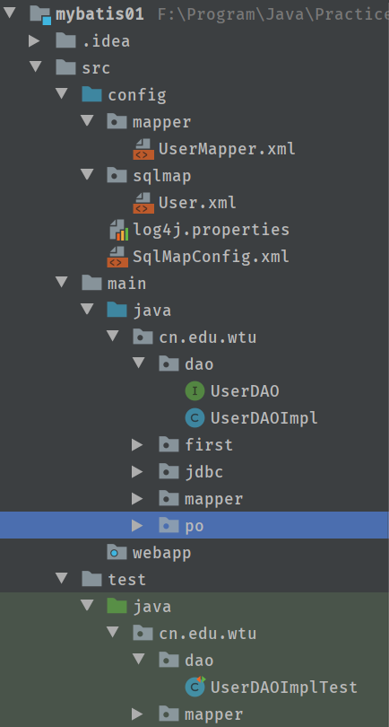
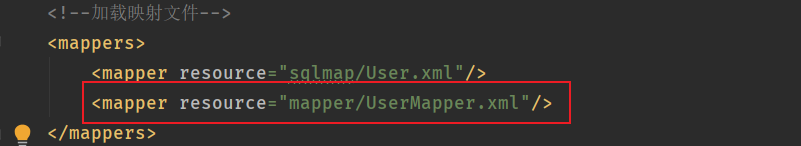
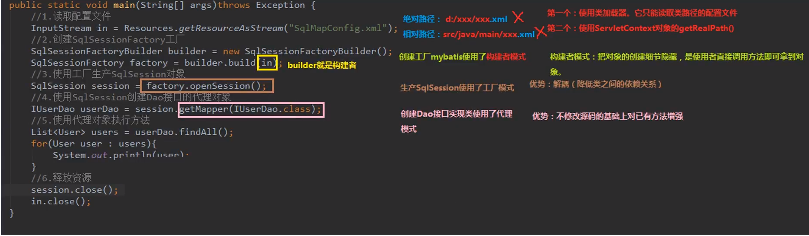
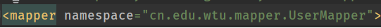
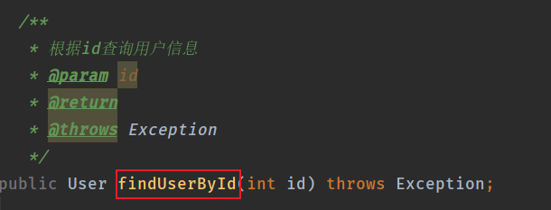
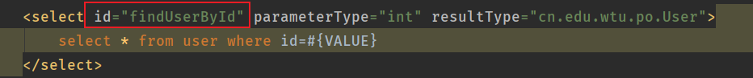
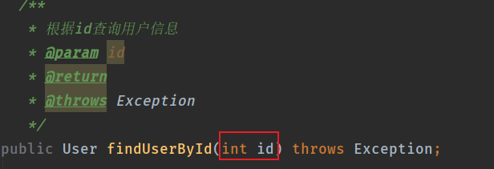
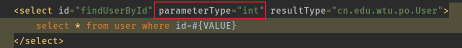
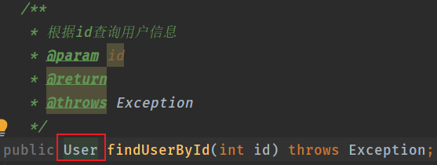
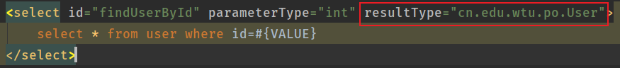

+ [author](https://github.com/3293172751)
+ 

# 第34节 开发dao方法

+ [回到目录](../README.md)
+ [回到项目首页](../../README.md)
+ [上一节](33.md)
> ❤️💕💕java的学习指南,从入门到大师篇章。Myblog:[http://cubxxw.com](http://cubxxw.com/)
---
[TOC]

## 概念

**简介**

使用Mybatis开发Dao，通常有两个方法，即原始Dao开发方法和Mapper接口开发方法。

**主要概念介绍：**

　　MyBatis中进行Dao开发时候有几个重要的类，它们是SqlSessionFactoryBuilder、SqlSessionFactory、SqlSession。

　　SqlSession中封装了对数据库的操作，如：查询、插入、更新、删除等。通过SqlSessionFactory创建SqlSession，而SqlSessionFactory是通过SqlSessionFactoryBuilder进行创建。

**1、SqlSessionFactoryBuilder**

　　SqlSessionFactoryBuilder用于创建SqlSessionFacoty，SqlSessionFacoty一旦创建完成就不需要SqlSessionFactoryBuilder了，因为SqlSession是通过SqlSessionFactory生产，所以可以将SqlSessionFactoryBuilder当成一个工具类使用，最佳使用范围是方法范围即方法体内局部变量。

**2、SqlSessionFactory**

　　SqlSessionFactory是一个接口，接口中定义了openSession的不同重载方法，SqlSessionFactory的最佳使用范围是整个应用运行期间，一旦创建后可以重复使用，通常以单例模式管理SqlSessionFactory。

**3、SqlSession**

　　SqlSession是一个面向用户的接口， sqlSession中定义了数据库操作，默认使用DefaultSqlSession实现类。

　　SqlSession中提供了很多操作数据库的方法：如：selectOne(返回单个对象)、selectList（返回单个或多个对象），SqlSession是线程不安全的，在SqlSesion实现类中除了有接口中的方法（操作数据库的方法）还有数据域属性，SqlSession最佳应用场合在方法体内，定义成局部变量使用，绝对不能将SqlSession实例的引用放在一个类的静态字段或实例字段中。

## SqlSession使用范围

- SqlSessionFactoryBuilder

通过`SqlSessionFactoryBuilder`创建会话工厂`SqlSessionFactory`将`SqlSessionFactoryBuilder`当成一个工具类使用即可，不需要使用单例管理`SqlSessionFactoryBuilder`。在需要创建`SqlSessionFactory`时候，只需要new一次`SqlSessionFactoryBuilder`即可。

- `SqlSessionFactory`

通过`SqlSessionFactory`创建`SqlSession`，使用单例模式管理`sqlSessionFactory`（工厂一旦创建，使用一个实例）。将来mybatis和spring整合后，使用单例模式管理`sqlSessionFactory`。

- `SqlSession`

`SqlSession`是一个面向用户（程序员）的接口。SqlSession中提供了很多操作数据库的方法：如：`selectOne`(返回单个对象)、`selectList`（返回单个或多个对象）。

`SqlSession`是线程不安全的，在`SqlSesion`实现类中除了有接口中的方法（操作数据库的方法）还有数据域属性。

`SqlSession`最佳应用场合在方法体内，定义成局部变量使用。

## 项目结构

## 原始dao方法

### UserDao.java

~~~java
package cn.edu.wtu.dao;

import cn.edu.wtu.po.User;

/**
 * @Package cn.edu.wtu.dao
 * @InterfaceName UserDao
 * @Description TODO
 * @Date 19/11/3 13:48
 * @Author LIM
 * @Version V1.0
 */
public interface UserDAO {
    /**
     * dao原始开发
     * 根据id查询用户信息
     * @param id
     * @return
     * @throws Exception
     */
    public User findUserById(int id) throws Exception;

    /**
     * 添加用户
     * @param user
     * @throws Exception
     */
    public void insertUser(User user) throws Exception;

    /**
     * 删除用户
     * @param id
     * @throws Exception
     */
    public void deleteUser(int id) throws Exception;
}
~~~

### UserDaoImpl.java

~~~java
package cn.edu.wtu.dao;

import cn.edu.wtu.po.User;
import org.apache.ibatis.session.SqlSession;
import org.apache.ibatis.session.SqlSessionFactory;

/**
 * @Package cn.edu.wtu.dao
 * @ClassName UserDAOImpl
 * @Description TODO
 * @Date 19/11/3 13:48
 * @Author LIM
 * @Version V1.0
 */
public class UserDAOImpl<id> implements UserDAO {
  /** 原生态的dao
   * 需要向dao实现类里注入SqlSessionFactory
   * 通过构造方法
   */
  private SqlSessionFactory sqlSessionFactory;

  public UserDAOImpl(SqlSessionFactory sqlSessionFactory) {
    this.sqlSessionFactory = sqlSessionFactory;
  }

  @Override
  public User findUserById(int id) throws Exception {
    SqlSession sqlSession = sqlSessionFactory.openSession();
    User user = sqlSession.selectOne("test.findUserById", id);
    // 关闭
    sqlSession.close();
    return user;
  }

  @Override
  public void insertUser(User user) throws Exception {
    SqlSession sqlSession = sqlSessionFactory.openSession();
    sqlSession.insert("test.insertUser", user);
    // 提交
    sqlSession.commit();
    // 关闭
    sqlSession.close();
  }

  @Override
  public void deleteUser(int id) throws Exception {
    SqlSession sqlSession = sqlSessionFactory.openSession();
    sqlSession.insert("test.deleteUser", id);
    sqlSession.commit();
    sqlSession.close();
  }
}
~~~

### UserDaoImplTest.java

~~~java
package cn.edu.wtu.dao;

import cn.edu.wtu.po.User;
import org.apache.ibatis.io.Resources;
import org.apache.ibatis.session.SqlSessionFactory;
import org.apache.ibatis.session.SqlSessionFactoryBuilder;
import org.junit.Before;
import org.junit.Test;

import java.io.IOException;
import java.io.InputStream;
import java.util.Date;

public class UserDAOImplTest {
  private SqlSessionFactory sqlSessionFactory;

  @Before
  public void setUp() throws IOException {
    InputStream is = Resources.getResourceAsStream("SqlMapConfig.xml");
    // 创建会话工厂
    sqlSessionFactory = new SqlSessionFactoryBuilder().build(is);
  }

  @Test
  public void testFindUserById() throws Exception {
    User user = new UserDAOImpl<>(sqlSessionFactory).findUserById(1);
    System.out.println(user.toString());
  }

  @Test
  public void testInsertUser() throws Exception {
    User user = new User();
    user.setId(100);
    user.setUsername("张宇");
    user.setSex("2");
    user.setBirthday(new Date());
    user.setAddress("襄阳");
    new UserDAOImpl<>(sqlSessionFactory).insertUser(user);
  }

  @Test
  public void testDeleteUser() throws Exception {
    new UserDAOImpl<>(sqlSessionFactory).deleteUser(25);
  }
}
~~~

## Mybatis的mapper接口（相当于dao接口）代理开发方法

### UserMapper.java

~~~java
package cn.edu.wtu.mapper;

import cn.edu.wtu.po.User;

import java.util.List;

/**
 * @Package cn.edu.wtu.mapper
 * @InterfaceName UserMapper
 * @Description TODO
 * @Date 19/11/3 13:51
 * @Author LIM
 * @Version V1.0
 */
public interface UserMapper {
  /** mapper代理开发和dao开发对比 mapper接口,相当于dao接口，
   * mybatis可以自动生成mapper接口实现类的代理对象
   */

    /**
     * 根据id查询用户信息
     * @param id
     * @return
     * @throws Exception
     */
  public User findUserById(int id) throws Exception;

    /**
     * 根据用户名查询用户列表
     * @param name
     * @return
     * @throws Exception
     */
  public List<User> findUserByName(String name) throws Exception;

    /**
     * 添加用户
     * @param user
     * @throws Exception
     */
    public void insertUser(User user) throws Exception;

    /**
     * 删除用户
     * @param id
     * @throws Exception
     */
    public void deleteUser(int id) throws Exception;

    /**
     * 更新用户
     * @param user
     * @throws Exception
     */
    public void updateUser(User user) throws Exception;
}
~~~

### UserMapper.xml

~~~xml
<?xml version="1.0" encoding="UTF-8" ?>
<!DOCTYPE mapper
        PUBLIC "-//mybatis.org//DTD Mapper 3.0//EN"
        "http://mybatis.org/dtd/mybatis-3-mapper.dtd">
<mapper namespace="cn.edu.wtu.mapper.UserMapper">

    <select id="findUserById" parameterType="int" resultType="cn.edu.wtu.po.User">
        select * from user where id=##{VALUE}
    </select>

    <select id="findUserByName" parameterType="java.lang.String" resultType="cn.edu.wtu.po.User">
        select * from user WHERE username LIKE '%${value}%'
    </select>

    <insert id="insertUser" parameterType="cn.edu.wtu.po.User">
        <selectKey keyProperty="id" order="AFTER" resultType="java.lang.Integer">
            SELECT LAST_INSERT_ID()
        </selectKey>
        insert into user(username,birthday,sex,address) value(##{username},##{birthday},##{sex},##{address})
    </insert>

    <delete id="deleteUser" parameterType="cn.edu.wtu.po.User">
        delete from user where id = ##{id}
    </delete>

    <update id="updateUser" parameterType="cn.edu.wtu.po.User">
        UPDATE user set username=##{username},birthday=##{birthday},sex=##{sex},address=##{address} where id=##{id}
    </update>
</mapper>
~~~

### 在测试之前需要在SqlMapConfig.xml中加载mapper.xml这个映射文件

### UserMapperTest.java

~~~java
package cn.edu.wtu.mapper;

import cn.edu.wtu.po.User;
import org.apache.ibatis.io.Resources;
import org.apache.ibatis.session.SqlSession;
import org.apache.ibatis.session.SqlSessionFactory;
import org.apache.ibatis.session.SqlSessionFactoryBuilder;
import org.junit.Before;
import org.junit.Test;

import java.io.InputStream;
import java.util.Date;
import java.util.List;

/**
 * @Package cn.edu.wtu.mapper
 * @ClassName UserMapperTest
 * @Description TODO
 * @Date 19/11/3 13:51
 * @Author LIM
 * @Version V1.0
 */
public class UserMapperTest {
    /**
     * mapper测试
     */
    private SqlSessionFactory sqlSessionFactory;
    @Before
    public void setUp() throws Exception {
        // 得到配置文件
        InputStream is = Resources.getResourceAsStream("SqlMapConfig.xml");
        // 创建会话工厂
        sqlSessionFactory = new SqlSessionFactoryBuilder().build(is);
    }

    @Test
    public void testFindUserById() throws Exception {
        // 创建会话
        SqlSession sqlSession = sqlSessionFactory.openSession();
        // 创建UserMapper对象,mybatis自动调用
        UserMapper userMapper = sqlSession.getMapper(UserMapper.class);
        User user = userMapper.findUserById(1);
        System.out.println(user.toString());
    }

    @Test
    public void testFindUserByName() throws Exception {
        // 创建会话
        SqlSession sqlSession = sqlSessionFactory.openSession();
        // 创建UserMapper对象,mybatis自动调用
        UserMapper userMapper = sqlSession.getMapper(UserMapper.class);
        List<User> list = userMapper.findUserByName("小明");
        System.out.println(list.toString());
    }

    @Test
    public void testInsertUser() throws Exception {
        // 创建会话
        SqlSession sqlSession = sqlSessionFactory.openSession();
        // 创建UserMapper对象,mybatis自动调用
        UserMapper userMapper = sqlSession.getMapper(UserMapper.class);
        User user = new User();
        user.setUsername("张思");
        user.setSex("1");
        user.setBirthday(new Date());
        user.setAddress("武汉江夏区");
        userMapper.insertUser(user);
    }

    @Test
    public void testDeleteUser() throws Exception{
        // 创建会话
        SqlSession sqlSession = sqlSessionFactory.openSession();
        // 创建UserMapper对象,mybatis自动调用
        UserMapper userMapper = sqlSession.getMapper(UserMapper.class);

        userMapper.deleteUser(28);
    }

    @Test
    public void testUpdateUser() throws Exception{
        // 创建会话
        SqlSession sqlSession = sqlSessionFactory.openSession();
        // 创建UserMapper对象,mybatis自动调用
        UserMapper userMapper = sqlSession.getMapper(UserMapper.class);
        User user = new User();
        user.setUsername("张于");
        user.setSex("1");
        user.setBirthday(new Date());
        user.setAddress("武汉江夏区");
        userMapper.insertUser(user);
        userMapper.updateUser(user);
    }
}
~~~

## 总结

### 原始dao开发问题

1. dao接口实现类方法中存在大量模板方法，设想能否将这些代码提取出来，大大减轻程序员的工作量。

2. 调用sqlsession方法时将statement的id硬编码了

3. 调用sqlsession方法时传入的变量，由于sqlsession方法使用泛型，即使变量类型传入错误，在编译阶段也不报错，不利于程序员开发。

### mapper开发

* 只需要编写两个文件，`mapper.java`,`mapper.xml`。即可，不需要类来继承它

* mapper开发只需要遵守几个规范即可

  * 在mapper.xml中namespace等于mapper接口地址
    

  * mapper.java接口中的方法名和mapper.xml中statement的id一致
    

    

  * mapper.java接口中的方法输入参数类型和mapper.xml中statement的parameterType指定的类型一致。
    

    

  * mapper.java接口中的方法返回值类型和mapper.xml中statement的resultType指定的类型一致。

    

     

     

* 其实，以上开发规范主要是对下边的代码进行统一生成：

  ~~~java
    User user = sqlSession.selectOne("test.findUserById", id);
    sqlSession.insert("test.insertUser", user);
    ......
  ~~~

## 一些问题总结

- 代理对象内部调用`selectOne`或`selectList`
  - 如果mapper方法返回单个pojo对象（非集合对象），代理对象内部通过selectOne查询数据库。
  - 如果mapper方法返回集合对象，代理对象内部通过selectList查询数据库。

- mapper接口方法参数只能有一个是否影响系统开发

mapper接口方法参数只能有一个，系统是否不利于扩展维护?系统框架中，dao层的代码是被业务层公用的。即使mapper接口只有一个参数，可以使用包装类型的pojo满足不同的业务方法的需求。

注意：持久层方法的参数可以包装类型、map...等，service方法中建议不要使用包装类型（不利于业务层的可扩展）。

### END 链接
+ [回到目录](../README.md)
+ [上一节](33.md)
+ [下一节](35.md)
---
+ [参与贡献❤️💕💕](https://github.com/3293172751/Block_Chain/blob/master/Git/git-contributor.md)