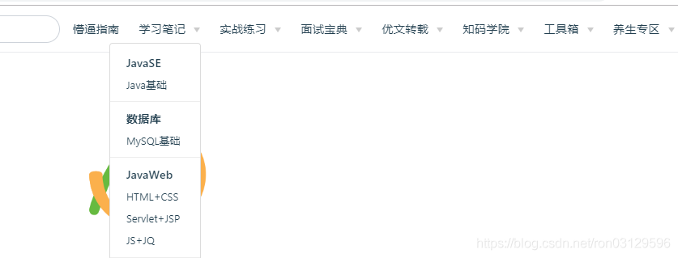
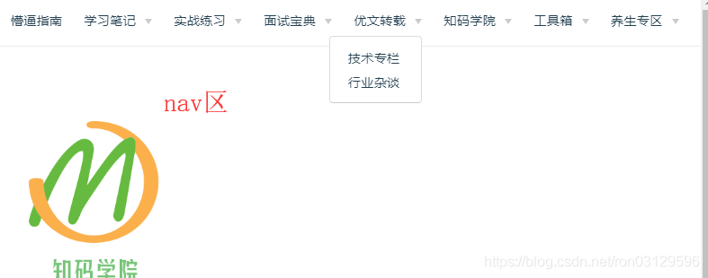
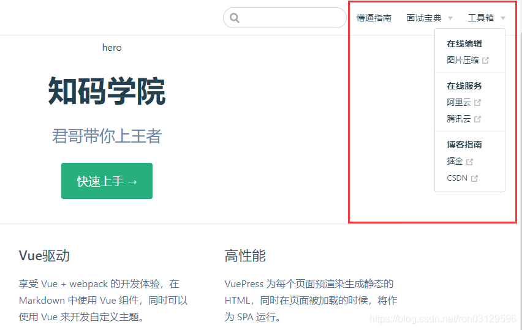
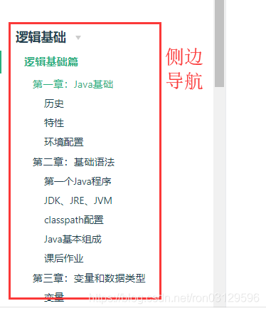
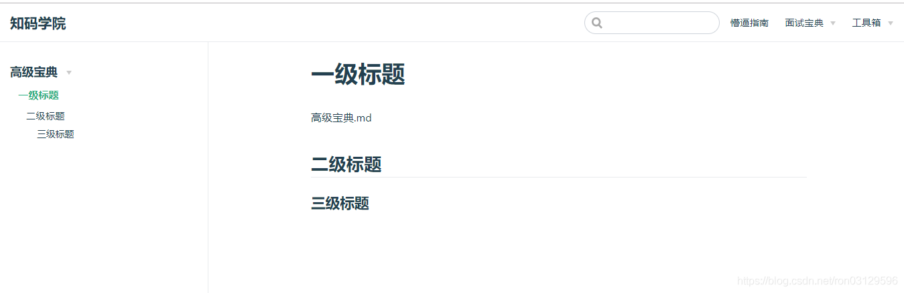

+ [author](https://github.com/3293172751)

# 第24节 君哥的vuepress搭建记录（v1)

+ [回到目录](../README.md)
+ [回到项目首页](../../README.md)
+ [上一节](23.md)
> ❤️💕💕VuePress入门文档。Myblog:[http://cubxxw.com](http://cubxxw.com/)
---
[TOC]

## 预览效果





## 开始搭建

### 前置环境

- 需要 node 环境和 npm 支持，这里不做讲解
- 如果不会安装 npm 请转到：[安装指引](https://www.npmjs.cn/getting-started/installing-node/)

```js
# npm设置淘宝源
npm config set registry https://registry.npm.taobao.org
npm config set disturl https://npm.taobao.org/dist

# 打开cmd 全局安装yarn
npm i -g yarn

# 设置yarn淘宝源，使用npm的同学，也是可以设置淘宝源
yarn config set registry https://registry.npm.taobao.org
yarn config set disturl https://npm.taobao.org/dist
yarn config set sass-binary-site https://npm.taobao.org/mirrors/node-sass
```


### vuePress 概述

- Vue 驱动的静态网站生成器
- 基于 markdown 语法生成网页
- 可自定义和扩展样式
- 可以发布至 github
- 详情请看官网 [vuepress](https://vuepress.vuejs.org/zh/)


### 安装初始化

+ 克隆到本地

  ```bash
  git clone https://github.com/it235/it235-vuepress.git
  rm -rf .git  #删除git目录，创建你自己的目录
  # 打开CMD命令行窗口
  cd 你自己改名后的文档目录
  
  # 安装vuepress 安装过程稍慢，如果卡住，按空格键继续
  yarn add -D vuepress 或 npm install -g vuepress
  
  yarn docs:dev  或 npm run docs:dev
  ```

  

- 全局安装

  ```bash
  npm install -g vuepress
  # v2
  npm install -g vuepress@next
  ```

- 创建个文件夹作为目录

  ```
  mkdir vuepress-blog
  # 该目录作为整本书的项目目录
  ```

- 项目初始化

  ```
  cd vuepress-blog
  npm init -y
  ```

  初始化后会生成一个`package.json`文件

- 在当前目录中创建一个`docs`目录

  ```
  mkdir docs
  # 主要存放博客书籍内容
  ```

- 首页内容书写 (默认主题提供)

  ```js
  ---
  home: true
  heroImage: /logo.jpg
  actionText: 快速上手 →
  actionLink: /zh/guide/
  features:
  - title: 简洁至上
    details: 以 Markdown 为中心的项目结构，以最少的配置帮助你专注于写作。
  - title: Vue驱动
    details: 享受 Vue + webpack 的开发体验，在 Markdown 中使用 Vue 组件，同时可以使用 Vue 来开发自定义主题。
  - title: 高性能
    details: VuePress 为每个页面预渲染生成静态的 HTML，同时在页面被加载的时候，将作为 SPA 运行。
  footer: MIT Licensed | Copyright © 2018-present Evan You
  ---
  ```


## 上传

**这一节是按照我自己的步骤操作的，[🐋 我的项目仓库地址](https://github.com/3293172751/3293172751.gitHub.io/)**

可以看出来我是使用了两个分支，一个是`master`主分支，一个是`blog`对应的是主分支下面的`dist`文件，这个文件是在`.vuepress/comfig.tg`文件中配置的，打包生成的位置。

也就是说，创建了两个`git`，对应两个分支，或许你可以只用创建一个`git`

**打包成THML的命令**

```
yarn docs:build 或 npm run docs:build
```


## 核心配置

- 在`docs`目录下创建`.vuepress`目录

  ```
  cd docs
  mkdir .vuepress
  # 主要存放配置
  ```

- 新建总配置文件`config.js`

  ```
  cd .vuepress
  touch config.js
  # config是整个项目的核心配置文件，所有菜单、栏目相关的配置均配置在该模块中
  ```

- 在`config.js`中加入内容

  ```js
  module.exports = {
      title: '知码学院',
      description: '君哥带你上王者',
      dest: './dist',
      port: '7777',
      head: [
          ['link', {rel: 'icon', href: '/logo.jpg'}]
      ],
      markdown: {
          lineNumbers: true
      },
      themeConfig: {
          nav: [{
              text: '懵逼指南', link: '/guide/'
          }],
          sidebar: {'/guide/':[
              {
                    title:'新手指南',
                    collapsable: true,
                    children:[
                      '/guide/notes/one',
                    ]
                  },
                  {
                    title:'知码学院',
                    collapsable: true,
                    children:[
                      '/guide/notes/two',
                    ]
                  }
              ]
          },
          sidebarDepth: 2,
          lastUpdated: 'Last Updated',
          searchMaxSuggestoins: 10,
          serviceWorker: {
              updatePopup: {
                  message: "有新的内容.",
                  buttonText: '更新'
              }
          },
          editLinks: true,
          editLinkText: '在 GitHub 上编辑此页 ！'
      }
  }
  ```

  上述配置中`themeConfig`处有 2 个关键配置，`nav`和`sidebar`，我们后续单独讲解

- 运行

  ```tsx
  vuepress dev docs
  ```


### 导航栏配置

- `nav`配置
  `nav`是顶部栏目导航

  

  接下来我们在当前目录创建一个 `nav.js

  

  ```
  touch nav.js
  # 因为config.js中引入了nav，所以我们要提供一个来存放栏目
  ```

- 编辑`nav.js`
  加入如下内容

  ```
  module.exports = [
      {
          text: '懵逼指南', link: '/guide/'
      },
      {
          text: '面试宝典', link: '/baodian/',
  		items: [
              {text: '初级开发篇', link: '/baodian/zero/'},
              {text: '中高进阶篇', link: '/baodian/high/'},
          ]
      },
      {
          text: '工具箱',
          items: [
  			{
                  text: '在线编辑',
  				items: [
  					{text: '图片压缩', link: 'https://tinypng.com/'}
  				]
              },
  			{
                  text: '在线服务',
  				items: [
  					{text: '阿里云', link: 'https://www.aliyun.com/'},
  					{text: '腾讯云', link: 'https://cloud.tencent.com/'}
  				]
              },
  			{
                  text: '博客指南',
  				items: [
  					{text: '掘金', link: 'https://juejin.im/'},
  					{text: 'CSDN', link: 'https://blog.csdn.net/'}
  				]
              }
          ]
      }
  ]
  ```

- nav 配置注意点

- - nav` 可以支持本地目录和链接

- `nav`由 text、link、items 组成

  - text：栏目名（项名）
  - link：链接，可以指向本地目录和 http 地址
  - items：可以包含多个 text 和 link，可以继续反复套用组成复杂的菜单

- `nav`配置时需要与本地的目录对应

  - 如上述我配置了懵逼指南和面试宝典栏目
  - 懵逼指南：对应的事`/guide/`，则我需要再`docs`目录下创建一个`guide`目录
  - 面试宝典：对应的是`/baodian/`，则我需要在`docs`目录下创建一个`baodian`目录
  - `baodian`子目录：上述配置中`baodian`下有 2 个子目录，则我需要在下面新建 2 个子目录与之对应

- 对应目录截图

  

  

- 


### 侧边栏配置


- ```
  sidebar
  ```

  ```
  sidebar
  ```

  是左侧标题导航，可以指定配置也可以设置为

  ```
  auto
  ```

  ```
  sidebar: 'auto'
  ```





- `sidebar`配置语法

  ```
  module.exports = {
  	'/guide/': require('../guide/sidebar'),
  
  	'/baodian/zero': require('../baodian/zero/sidebar'),
  	'/baodian/high': require('../baodian/high/sidebar'),
  }
  ```

  - `/guide/`：该 key 是与上述的`nav`中 link 对应，在请求`nav`时会自动切换当前的侧边目录，所以需要该配置
  - `/baodian/zero`同理
  - 后续的`require`表示引入一个指定目录的`sidebar.js`文件，其本身可以直接写在这里，但为了方便维护我们需要将每个模块的侧边栏 js 抽取出来，单独存放在内容模块的目录下

- `sidebar.js`

  这里我贴出目录：`/docs/guide/sidebar.js`文件内容

  ```
  module.exports = [
  		{
  		  title:'新手指南',
  		  collapsable: true,
  		  children:[
  			'/guide/notes/one',
  		  ]
  		},
  		{
  		  title:'知码学院',
  		  collapsable: true,
  		  children:[
  			'/guide/notes/two',
  		  ]
  		}
  	]
  ```

  参数解析

  - `title`：表示侧边栏大标题
  - `collapsable`：是否可收缩
  - `children`：具体的`.md`文件，这里无需指定后缀

  预览效果如下

  

  


### 静态资源配置


静态资源是最重要的一部分，比如图片，比如`js`，比如`css`


vuepress 程序默认的图片目录是`/docs/.vuepress/public`


```
cd .vuepress
mkdir public
```


- 图片

  比如我们要指定首页显示图片，那么需要将首页内容中的图片路径更改成如下

  ```
  # /docs/.vuepress/public目录下有一张 logo.jpg的图片
  heroImage: /logo.jpg
  ```

  即`/logo.jpg`就是指`/docs/.vuepress/public/logo.jpg`

- css

  css 与图片路径一样，比如 js 中要加载我们指定的 css 文件，那么可以像如下这样

  - 在 public 目录下新建一个 css 目录

    ```
    cd public
    mkdir css
    touch style.css
    ```

    编辑 css 内容，加入如下 css 做测试（你也可以自定义其他内容）

    ```
    a{color:#333;text-decoration:none; }
    ```

  - 修改`.vuepress`下的`config.js`

    ```
    # 修改head属性如下
    head: [
            ['link', {rel: 'icon', href: '/logo.jpg'}],
            ["link", { rel: "stylesheet", href: "/css/style.css" }]
        ],
    ```

  - 重启预览效果

- js

  如果我们要自定义一些 js 动态效果，我们可以也可以像 css 操作那样

  - 在 public 目录下新建一个`js`目录

    ```
    cd public
    mkdir js
    touch main.js
    ```

    在 js 中加入一些测试内容

    ```
    function init(){
        console.log("终于可以为所欲为了");
    }
    //因为界面加载原因，我们延迟500ms再调用init
    setTimeout("init()",500)
    ```

  - 修改`.vuepress`下的`config.js`

    ```
    # 修改head属性如下
    head: [
            ['link', {rel: 'icon', href: '/logo.jpg'}],
            ["link", { rel: "stylesheet", href: "/css/style.css" }],
            ["script", { charset: "utf-8", src: "/js/main.js" }],//新加入
        ],
    ```

  - 重启预览效果


### 完整效果配置


更新中…


### 添加评论


### 推送到 github


### 发布到 nginx


## END 链接
+ [回到目录](../README.md)
+ [上一节](23.md)
+ [下一节](25.md)
---
+ [参与贡献❤️💕💕](https://github.com/3293172751/Block_Chain/blob/master/Git/git-contributor.md)